# Kiến trúc — Claude HowTo Academy

Tài liệu này mô tả cách website được tổ chức để có thể thêm bài học, câu hỏi và bài thực hành **chỉ bằng dữ liệu**, không phải sửa giao diện.

## Công nghệ đã chọn

| Thành phần | Lựa chọn | Lý do |
| --- | --- | --- |
| Framework | Next.js 16 (App Router) + TypeScript, `output: "export"` | Xuất ra site tĩnh, chạy trên mọi static host (GitHub Pages, Netlify, S3); không cần máy chủ Node.js |
| Giao diện | Tailwind CSS v4 + component kiểu shadcn/ui (Radix UI + cva) | shadcn/ui là mã nguồn copy-paste; registry bị chặn trong môi trường build nên các component được viết tay theo đúng mẫu shadcn |
| Icon | lucide-react | Bộ icon nhất quán, nhẹ |
| Animation | motion (Framer Motion) | Chỉ dùng cho thông báo XP/huy hiệu; tôn trọng `prefers-reduced-motion` |
| Kéo thả | @dnd-kit | Hỗ trợ chuột, cảm ứng và bàn phím; mọi thao tác kéo thả đều có nút thay thế |
| Code editor | Monaco (tự host trong `public/monaco`) | Không phụ thuộc CDN; có ô soạn thảo dự phòng nếu Monaco không tải được |
| Sơ đồ | Mermaid (render phía trình duyệt, nạp động) | Sơ đồ nguyên lý trong bài học, đổi màu theo dark mode |
| Lưu tiến độ | localStorage (có kiểm tra schema, sao lưu khi hỏng, xuất/nhập JSON) | Không cần đăng nhập, không gửi dữ liệu ra ngoài |
| Kiểm thử | Vitest (logic) + Playwright + axe-core (E2E, accessibility) | Kiểm thử engine độc lập với giao diện |

Chưa dùng: **MDX** (nội dung là dữ liệu có kiểu TypeScript để kiểm tra cấu trúc 12 phần, đánh chỉ mục tìm kiếm và tính fingerprint câu hỏi), **KaTeX** (chưa có bài cần công thức), **SQLite + Prisma** (chưa cần máy chủ — xem phần "Mở rộng").

## Sơ đồ các lớp

```mermaid
flowchart LR
  subgraph Content["Nội dung (src/content)"]
    C1["course.ts: 12 chương"]
    C2["lessons/*.ts"]
    C3["questions/*.ts"]
    C4["labs/*.ts"]
  end
  subgraph Engine["Logic (src/lib/engine)"]
    E1["question: fingerprint, validate, adaptive, evaluate"]
    E2["terminal: shell + git mô phỏng"]
    E3["prompt: rule-based evaluator"]
    E4["code: Web Worker test runner"]
    E5["tokens: ước tính token"]
  end
  subgraph Store["Lưu trữ (src/lib/progress)"]
    S1["schema + actions thuần"]
    S2["store: localStorage"]
  end
  subgraph UI["Giao diện (src/components, src/app)"]
    U1["Trang học 3 cột"]
    U2["Quiz runner"]
    U3["5 Practice Labs"]
    U4["Trang chủ, tiến độ"]
  end
  Content --> Engine
  Content --> UI
  Engine --> UI
  UI --> Store
  Store --> UI
```



## Cấu trúc thư mục

```text
academy/
├── src/
│   ├── app/                    # Các route (đều được prerender tĩnh)
│   │   ├── page.tsx            # Trang chủ
│   │   ├── hoc/                # Lộ trình + trang bài học /hoc/[chapter]/[lesson]
│   │   ├── thuc-hanh/          # 5 Practice Labs
│   │   ├── kiem-tra-dau-vao/   # Bài đánh giá năng lực
│   │   ├── tien-do/            # Bảng tiến độ, huy hiệu, ghi chú, lịch sử
│   │   └── tim-kiem/           # Tìm kiếm toàn bộ bài học
│   ├── content/                # NỘI DUNG — chỉ dữ liệu
│   │   ├── course.ts           # 12 chương và đề cương bài học
│   │   ├── registry.ts         # Nơi đăng ký bài học + ngân hàng câu hỏi
│   │   ├── lessons/            # Mỗi bài một file (12 phần bắt buộc)
│   │   ├── questions/          # Mỗi bài một ngân hàng câu hỏi
│   │   ├── labs/               # Dữ liệu cho 5 lab
│   │   ├── widgets/            # Dữ liệu cho mô phỏng trong bài
│   │   └── placement.ts        # Bài đánh giá đầu vào
│   ├── lib/
│   │   ├── types/content.ts    # Schema của toàn bộ nội dung
│   │   ├── engine/             # LOGIC ĐÁNH GIÁ — thuần, có unit test
│   │   ├── progress/           # LƯU TRỮ — schema, actions thuần, store
│   │   └── search/             # Chỉ mục và truy vấn tìm kiếm
│   └── components/             # UI COMPONENTS
├── tests/unit/                 # Vitest
├── e2e/                        # Playwright + axe
└── scripts/                    # copy-monaco, serve-static
```

## Mô hình dữ liệu

Schema nằm trong `src/lib/types/content.ts` (nội dung) và `src/lib/progress/schema.ts` (tiến độ).

| Thực thể | Nơi định nghĩa | Ghi chú |
| --- | --- | --- |
| Course, Chapter | `Course`, `Chapter` | Đề cương; bài có `lessonId` là đã phát hành |
| Lesson | `Lesson` | `blocks` gồm đủ 12 loại phần |
| LearningObjective | `Lesson.objectives` | Câu hỏi tham chiếu qua `learningObjective` |
| Question | `Question` (12 dạng) | Có `questionId`, `conceptId`, `difficulty`, `thinkingSkill`, đáp án hoặc rubric |
| QuestionAttempt | `AttemptRecord` | Lưu fingerprint và khoá ngữ nghĩa để chống trùng giữa các phiên |
| PracticeLab | `LabMeta` + dữ liệu từng lab | Ghi rõ phần nào là mô phỏng |
| Project | `PROJECT`, `PROJECT_STEPS` | Lab 4 |
| UserProgress | `ProgressState` | Có `version`, kiểm tra khi đọc |
| Achievement | `BADGES` + `ProgressState.badges` | Điều kiện là hàm thuần |
| Bookmark | `ProgressState.bookmarks` | Danh sách `lessonId` |

## Các quyết định quan trọng

- **Engine thuần, UI mỏng.** Mọi phép chấm điểm, chọn câu hỏi, mô phỏng terminal và tính XP là hàm thuần (đầu vào → đầu ra), nên kiểm thử được bằng Vitest mà không cần trình duyệt.
- **Không giả vờ có AI.** Chưa kết nối AI API: chấm bài tự luận bằng rubric quy tắc và luôn ghi rõ giới hạn; panel “Gợi ý” cung cấp prompt để người học tự hỏi Claude.
- **Mô phỏng được gắn nhãn.** Terminal ghi “MÔ PHỎNG”, số token ghi “ước tính”. Code trong Debug Challenge chạy thật trong Web Worker có giới hạn 3 giây.
- **Tiến độ an toàn.** Dữ liệu hỏng được sao lưu sang khoá `cha:progress:v1:backup:<thời gian>` thay vì bị xoá; người học có thể xuất/nhập file JSON.
- **XP chỉ tính một lần** cho mỗi câu hỏi, bài học, lab (khoá idempotent) — không khuyến khích làm lại câu cũ để lấy điểm.

## Mở rộng sau này

- Lưu phía máy chủ: thêm một adapter cho `store.ts` (ví dụ API + SQLite/Prisma) mà không đổi `actions.ts`.
- Chấm bằng AI: thêm evaluator mới bên cạnh `rubric.ts`, giữ rubric quy tắc làm phương án dự phòng.
- Triển khai dưới đường dẫn con (GitHub Pages): đặt `basePath` trong `next.config.ts` và biến `NEXT_PUBLIC_BASE_PATH` (Monaco đã đọc biến này).
